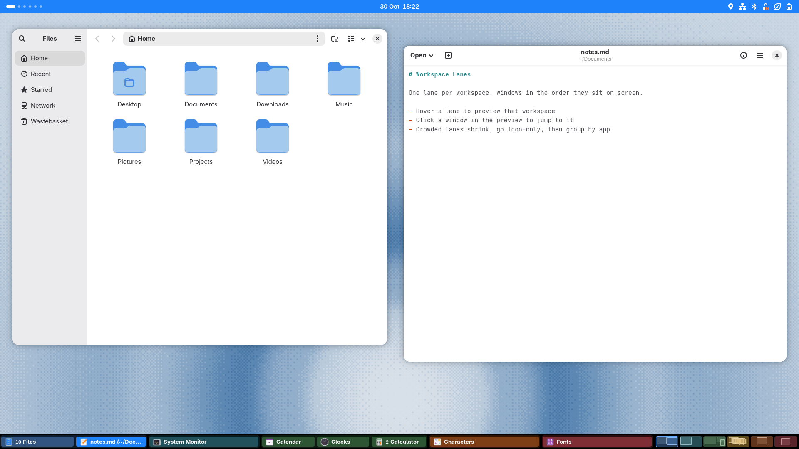

# Workspace Lanes

A taskbar laid out like your desktop: one lane per workspace, with each
lane's windows in the order they sit on screen.

A GNOME Shell 50 extension that replaces the built-in Window List. Windows
are grouped by workspace (1 → n), then ordered left to right on screen,
re-sorting live as you move them.


Two layouts, switchable from Settings or by right-clicking empty space on
the bar:

- **Workspace lanes** (default): the bar is split into one even-width
  lane per workspace, and each window's button sits in its workspace's
  lane. Crowded lanes collapse in stages: labels shrink, then buttons go
  icon-only, then windows of the same app merge into one icon with a
  count. Hover a lane for a live preview of that workspace; click a window
  in the preview to jump to it, or the empty space to switch workspace.
  Clicking empty space in a lane switches workspace, scrolling on the bar
  moves between workspaces.
- **Window list**: looks and behaves like Window List (with its workspace
  switcher on the right) but with the same spatial ordering. Empty
  workspaces take a quarter of the width of ones with windows, and you can
  drag the divider before the switcher to give it more or less room
  (double-click the divider to reset it).





Monitors that don't have workspaces (when workspaces are on the primary
monitor only) get a plain list of their own windows, sorted left to right.

While you switch between an app's windows with Alt+` (or between windows
with Alt+Tab), the selected window's button is highlighted on the taskbar,
so you can see which one you're about to pick and where it is. GNOME's own
switcher and shortcuts are used as they are.

## Install

From a clone of this repository:

```bash
./install.sh
```

This symlinks `workspace-lanes@truenorth-tools/` into
`~/.local/share/gnome-shell/extensions/`. On Wayland, log out and back in,
then run the script again: it enables Workspace Lanes and disables Window
List. Because it's a symlink, later code edits only need another log out
and back in to take effect.

To go back to Window List:

```bash
gnome-extensions disable workspace-lanes@truenorth-tools
gnome-extensions enable window-list@gnome-shell-extensions.gcampax.github.com
```

## Testing without logging out

Install `mutter-devkit` (e.g. `sudo dnf install mutter-devkit` on Fedora),
then run a GNOME Shell in a window with the extension enabled:

```bash
./test-shell.sh                      # one 1920x1080 monitor
./test-shell.sh 1920x1080 1280x1024  # one monitor per size given
```

It runs with a throwaway home folder and settings, so nothing changed in
it (accent colour, workspaces, extensions) reaches your own session. It
starts from your wallpaper, light/dark style and accent colour, and loads
the extension straight from this folder, so restart it to try code edits.
Close the window or press Ctrl+C to stop it.

## Files

- `extension.js`: window model, ordering, button rows (`ButtonRow`, collapse logic), workspace lanes (`Section`), bar
- `buttons.js`: window and app buttons (from Window List)
- `preview.js`: hover preview of a workspace
- `switcher.js`: follows the window selected in GNOME's Alt+` and Alt+Tab switchers
- `colors.js`: workspace colour coding (generated stylesheet, top bar tint, accent colour)
- `palette.js`: default colours and colour strengths, shared with the settings window
- `backgrounds.js`: optional per-workspace backgrounds (a shader on the shell's background actors)
- `lightShell.js`: optional light top bar and menus in Light style
- `workspaceIndicator.js`, `workspacePrefs.js`: from Window List (switcher thumbnails and highlighting added, thumbnails sized by use)
- `divider.js`: the draggable divider between the window list and the switcher
- `prefs.js`: settings window (Taskbar and Colours pages; Workspaces page from `workspacePrefs.js`)
- `screenshots/`: images used in this README (not part of the extension)

Licensed GPL-2.0-or-later, as it is derived from GNOME Shell Extensions'
Window List.
